# Spectra → Structures: MetFrag-assisted ranking for Enveda CASMI 2026

[](https://github.com/Agnuxo1/enveda-casmi-2026-metfrag-ranking/actions/workflows/runtime.yml) [](LICENSE) -2a78d6?style=flat-square&logo=python&logoColor=white) [](https://www.kaggle.com/competitions/enveda-CASMI26-molecule-id-mass-spectra)

**Predicting the 2D structure of natural products from LC-MS/MS spectra, ranked by evidence.**
Our entry to the [Enveda CASMI 2026 Kaggle competition](https://www.kaggle.com/competitions/enveda-CASMI26-molecule-id-mass-spectra)
(MRR@25, 4,200+ teams, US$50,000).


| | |
|---|---|
| **Task** | For each unknown molecule (1–9 timsTOF MS/MS spectra), return up to 25 candidate SMILES, best first |
| **Metric** | Mean reciprocal rank @25 on the InChIKey connectivity block after RDKit 2026.03.3 tautomer canonicalisation |
| **Base** | The strongest public pipeline (0.465 → 0.472), credited below, run unchanged as our **control** |
| **Our contribution** | An independent, physics-based voter: **MetFrag 2.6.11 in-silico fragmentation** re-orders ranks 2–25 |
| **Method** | Pre-registered hypotheses, a fixed control, paired bootstrap and molecule-disjoint folds; negatives logged |
| **Author** | Francisco Angulo de Lafuente ([@Agnuxo1](https://github.com/Agnuxo1) · Kaggle `franciscoangulo`) |

---

**Contents** — [28 October: experimental weighting models and checked submission state](#28-october-experimental-weighting-models-and-checked-submission-state) · [Highlights](#highlights) · [Background](#background) · [How it works](#how-it-works) · [Results](#results) · [Reproduce](#reproduce) · [Repository layout](#repository-layout) · [Credits](#credits) · [Limitations and notes](#limitations-and-notes) · [Real-world applications](#real-world-applications) · [Possible improvements](#possible-improvements) · [Future work](#future-work) · [License](#license) · [Bibliography](#bibliography)

## 28 October: experimental weighting models and checked submission state

The repository now includes a reusable [CPU trainer](src/experimental_weighting.py)
and [fixed-blend inference utility](src/weighting_predict.py), rather than only
metric summaries. The trainer exports three estimators and verifies that loading
each export reproduces its predictions exactly. These use the **first31 columns
of the original sim-ranker feature matrix**, not the features of the current
MetFrag notebook, and are not automatically inserted into that notebook.

Three fixed interventions were tested on observed-spectrum features under two
simulated retrieval regimes, training on six libraries and reserving250 Enveda
molecules (500 query groups):

| Method | Library removed MRR@25 | True-structure spectra removed MRR@25 |
|---|---:|---:|
| Fixed HGB control | 0.79122 | 0.64561 |
| M4: equal total weight per query | 0.79673 | 0.62628 |
| M5: positive candidate weight ×5 | 0.81035 | 0.63504 |
| M6: fixed 50/50 M4/M5 probability blend | **0.81796** | 0.64308 |

<p align="center">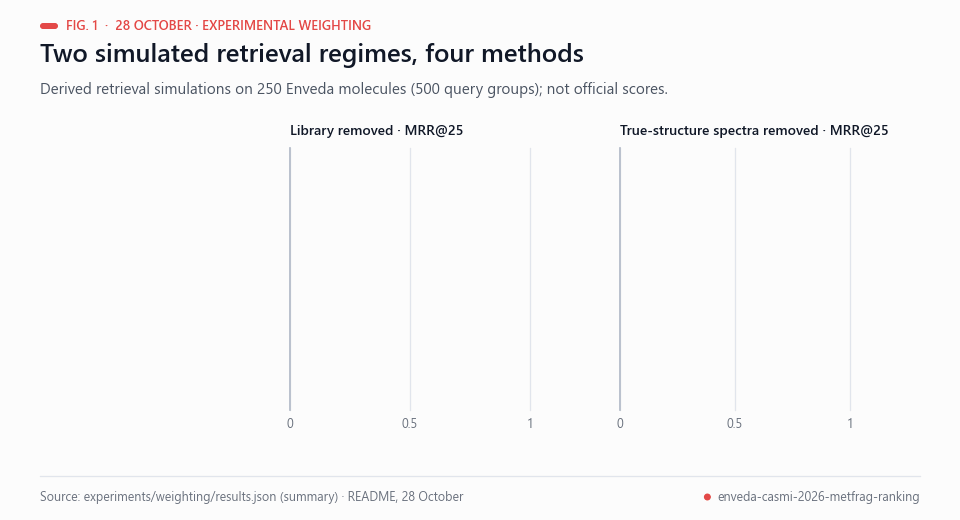<br><sub>Fig. 1 — MRR@25 in the two simulated regimes. Data: experiments/weighting/results.json. Not official scores.</sub></p>

In the library-removed regime, the blend improves MRR by **+0.02674**, with
95% molecule-bootstrap interval **[+0.00604,+0.04782]**. This positive result
is retained alongside the second regime's delta -0.00254, interval
[-0.01831,+0.01409]. These exploratory intervals are not multiplicity-adjusted.

<p align="center">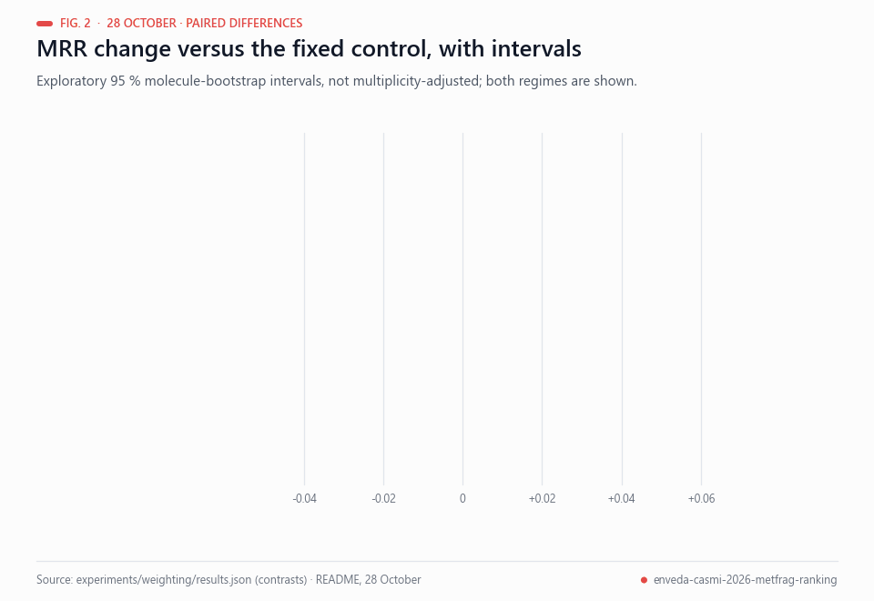<br><sub>Fig. 2 — Paired differences with exploratory intervals (not multiplicity-adjusted). Data: experiments/weighting/results.json.</sub></p>

The blend improves overall mean MRR by **+0.01210**, molecule-cluster bootstrap
95% CI [-0.00150,+0.02557];64 groups improve and51 worsen. The positive first
regime and slightly negative second regime are both retained. These are derived
retrieval simulations, **not official scores or a comparison with the current
MetFrag candidate**. Exact chemical overlap across libraries cannot be ruled
out from this numeric matrix alone. [All results](experiments/weighting/results.json)
and [per-query outcomes](experiments/weighting/group_metrics.csv) are available.

```sh
pip install -r requirements-weighting.txt
python src/experimental_weighting.py --data /path/to/sim_rank_rows_nofp.npz --out output --export-models
python src/weighting_predict.py --features candidate_features.npy --models output --out scores.npy
```

The fitted estimators are also committed in
[`models/experimental-weighting/`](models/experimental-weighting/); their hashes
and successful export-roundtrip checks are recorded in the results JSON.

**Official-state update, 28 October:** the authenticated Kaggle API now reports
C00 submission **57729674 as COMPLETE, public score 0.472**. This verifies our
reproduction of the credited public control, improving the account's earlier
best 0.348 by **+0.124**. It is not evidence of a MetFrag improvement: C01's
notebook completed, but a scored C01 competition receipt has not yet been
verified. [Checked receipt](experiments/official-state-20261028.json).
No duplicate C00 submission was made by this update.

<p align="center">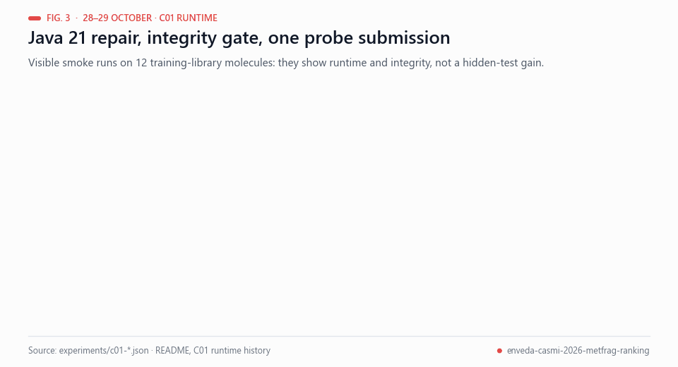<br><sub>Fig. 3 — C01 runtime and integrity history. Data: experiments/c01-*.json. Visible smoke runs, not a hidden-test score.</sub></p>

**C01 runtime history:** version 4's completed Kaggle output scored **zero molecules**:
its GPU image used Java 17, while the jar's main class requires Java 21
(class-file version 65). Its `submission.csv` remained the control, so it is
not submitted again as an improvement. **Version 5 already succeeded** with its
own Java 21 fallback: **40/40 jobs, 12 visible molecules scored and 12 lists
reordered**, with no Java failures and 167 seconds in MetFrag. The browser's
selected Version 5 output and report hash are preserved in
[this positive runtime record](experiments/c01-version5-visible-proof.json).
Those are training-library smoke cases, not a hidden-test score. They must not
be erased by the earlier failure or by subsequent packaging work.

The hardened stage now checks JVM/class
compatibility before reading spectra, honours an explicit `METFRAG_JAVA`
executable, rejects failed Java calls even if an old CSV exists, and applies
only molecules whose every selected spectrum scored successfully. Zero fully
scored molecules is reported as **unapplied**, rather than a successful change.
Two offline regressions cover the observed Java-17 failure and Java-21
compatibility; these are software checks, not evidence of better chemistry.
Private Kaggle notebook version **7** now carries a pinned official
[Temurin 21 JRE dataset](https://www.kaggle.com/datasets/franciscoangulo/temurin21-jre-linux-x64-pinned).
The [bootstrap](src/bootstrap_java21.py) verifies the vendor archive's byte count
and SHA-256 before extracting it into this notebook's own working directory;
it leaves system Java unchanged. Vendor licences remain inside the unmodified
archive. Dataset version1 was automatically unpacked by Kaggle, so notebook6
stopped before MetFrag with `StopIteration`. Dataset version2 preserves the
byte-identical archive as `.tar.gz.bin`; Kaggle's file listing verifies its
52,181,297 bytes. The bootstrap now runs before the expensive pipeline.
[Runtime provenance](experiments/c01-runtime-repair.json) records the
release and hashes. **Version 7 completed successfully:** Java 21 is compatible,
40/40 jobs scored 12 visible molecules and reordered 12 lists in 186 seconds.
Its final output SHA256 is identical to the successful version 5 output.
The [independent integrity gate](src/check_c01_output.py) verifies all 400 IDs,
all 400 leaders and all 400 candidate sets against the saved control.
[Checked result](experiments/c01-version7-integrity.json).

**Official C01 submission 57753743 was sent on 29 October, 00:47 UTC**, using
notebook version 7 and `submission.csv`. An independent API readback reports
**PENDING, no public score yet**; C00 remains COMPLETE at 0.472.
[Submission receipt](experiments/c01-official-submission-20261029.json).
This is the single exploratory official probe fixed by the E01 rule and
reviewed with JEV before sending. Weight 0.25 and the six-spectrum rule are
unchanged. Visible smoke results establish runtime and integrity, not a
hidden-test gain; the actual competition rerun determines that score.

## Highlights

- **MetFrag carries strong, independent evidence.** On the public labelled panel, ordering each molecule's final
  25 candidates by MetFrag alone puts the correct structure at a mean reciprocal rank of **0.554** — better than
  the learned spectrum↔structure network (**0.441**) and 3.6× the random-order expectation (**0.153**).
- **Leader-safe by construction.** The control's rank-1 answer and its candidate set are never changed; MetFrag only
  re-orders ranks 2–25, where a wrong move costs little and a right one is worth up to 0.5 per molecule.
- **Positive, statistically supported gain on the panel.** At weight 0.25 the deployable rule improves the control by
  **+0.0017 MRR, 95% CI [+0.0001, +0.0040]**; larger weights reach +0.0038 with wider intervals.
- **Internet-off deployment candidate.** The unmodified MetFrag jar uses the pinned JRE 21 dataset;
  the selected GPU image's built-in Java 17 is incompatible. The stage enforces
  its 9-hour session deadline and falls back to the control on failure. A live
  successful run of the repaired version is still required.
- **Re-based from the historical0.348 lineage onto the credited0.472 public recipe.**
  Our C00 reproduction now has a verified public score of **0.472**; the MetFrag layer is a measured
  offline candidate for improving that control.


## Background

<p align="center">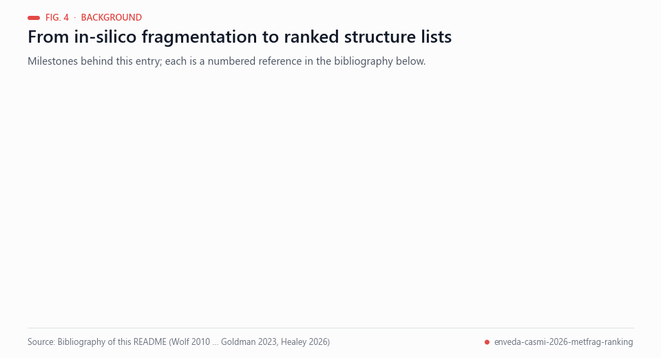<br><sub>Fig. 4 — Milestones behind this entry. Sources: bibliography below.</sub></p>

Identifying an unknown small molecule from tandem mass spectra is a ranking problem: a database or generator proposes
candidate structures, and a method scores how well each explains the measured peaks. In-silico fragmenters such as
MetFrag break each candidate's molecular graph and compare the predicted fragments with the spectrum [[1](#ref-1)]; its
2016 relaunch added further scoring and filtering terms (for example retention time and suspect lists) and a
command-line interface for high-throughput workflows [[2](#ref-2)], and the CASMI contests benchmark such methods on
blind spectra [[3](#ref-3)]. Systems such as CSI:FingerID and SIRIUS 4 combine fragmentation trees with machine learning
to search structure databases [[4](#ref-4), [5](#ref-5)], and recent models predict fragmentation graphs [[6](#ref-6)] or predict
fingerprints and fragment substructures from spectra, using transformers over peak formulas [[7](#ref-7)]. Even so, annotation remains the bottleneck of
metabolomics, and reported identifications are best accompanied by an explicit confidence level
[[8](#ref-8), [9](#ref-9)].

Rank fusion gives a simple way to combine independent voters. Reciprocal-rank fusion adds `1/(k + rank)` terms from
each ranked list and was shown to outperform Condorcet fusion and individual rank-learning methods [[10](#ref-10)]; the public 0.472
recipe credited in this repository applies the same idea to a neural voter, and our rule adds MetFrag as a second
voter on ranks 2–25 only. Offline differences are reported with a paired bootstrap, an application of the bootstrap [[11](#ref-11)]. The candidate pools
are drawn from libraries such as COCONUT [[12](#ref-12)] and PubChem [[13](#ref-13)], structures are canonicalised with
RDKit [[14](#ref-14)] before the InChIKey connectivity block is compared, and the task itself is the Enveda CASMI 2026
Kaggle competition [[15](#ref-15)]. Natural products matter because they remain a major source of new drugs
[[16](#ref-16)].

Related public work by the author: [`s6e9-honest-ceiling`](https://github.com/Agnuxo1/s6e9-honest-ceiling) (fold-safe
ensembling on a Kaggle Playground task, with a power analysis),
[`small-juries-early-verdicts`](https://github.com/Agnuxo1/small-juries-early-verdicts) (a pre-registered study) and
[`biohub-cell-tracking-st-flow`](https://github.com/Agnuxo1/biohub-cell-tracking-st-flow) (a reproducible Kaggle
baseline with conservative gates). In this competition, our earlier September lineage (v1–v62, best public score 0.348)
was retired once the public 0.472 recipe appeared; cycle 2 on 28–29 October re-based the work on that credited
control and added the MetFrag voter as a single exploratory probe.

## How it works

### 1 · Candidate generation and the 0.465 fusion (public, unchanged)
Three engines propose structures within 10 ppm of the neutral mass: a library/analogue engine over 0.71 M stored
structures (training set + COCONUT), a second engine over ChEBI, LIPID MAPS and PubChemLite, and a PubChem channel
that screens 105.9 M structures with fingerprint models and a documentation prior. Identity-aware fusion merges them
and the GLACIER/ICEBERG forward models re-order same-formula candidates.

<p align="center">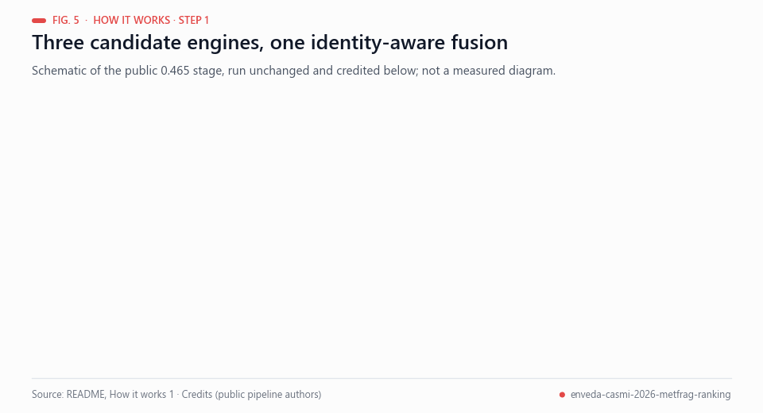<br><sub>Fig. 5 — Schematic of the public candidate stage (step 1), credited below and run unchanged.</sub></p>

### 2 · Leader-safe neural reciprocal-rank fusion (public, unchanged)
A spectrum↔structure network re-ranks the list with reciprocal-rank fusion. Rank 1 uses neural weight 0.25; ranks
2–25 use 0.75 — the public 0.472 recipe.


### 3 · MetFrag voter on ranks 2–25 (this work)
[MetFrag](https://github.com/ipb-halle/MetFragRelaunched) (Ruttkies *et al.*, 2016) breaks every candidate's
molecular graph *in silico* (up to two bond cleavages), and scores how much of the measured MS/MS intensity its
fragments explain. For each molecule we run it on up to six spectra, normalise per spectrum and average, then fuse:

$$s_i = \frac{1}{3 + \mathrm{pos}_i^{\text{control}}} + \frac{w}{3 + \mathrm{rank}_i^{\text{MetFrag}}},\qquad i \in \text{ranks } 2\text{–}25,\quad w = 0.25$$


*Green peaks: fragments explained by the correct structure, which the pipeline had placed second; orange: decoys.*

## Results

### Offline: does MetFrag help? (experiment E01, public labelled panel, 118 molecules)


| Rule (rank 1 fixed) | MRR | Δ vs control | 95% CI (paired bootstrap, 4,000) | Folds (3, molecule-disjoint) |
|---|---|---|---|---|
| Control (0.472 recipe) | 0.9128 | — | — | — |
| + MetFrag, w = 0.25 (**C01 candidate**) | 0.9146 | **+0.0017** | [+0.0001, +0.0040] | +0.0005 / +0.0047 / 0.0000 |
| + MetFrag, w = 0.50 | 0.9142 | +0.0014 | [−0.0028, +0.0054] | +0.0018 / +0.0065 / −0.0042 |
| + MetFrag, w = 0.75 | 0.9166 | +0.0038 | [−0.0018, +0.0105] | +0.0053 / +0.0101 / −0.0042 |

The panel is drawn from library molecules, so the control already ranks ~88% of them first; only about 15 molecules
can move at all. On the hidden natural-product test the control's MRR is ~0.47, so far more answers sit in ranks
2–25, which is exactly where the voter acts.

### Kaggle submissions (cycle 2, 28 Oct 2026)

<p align="center">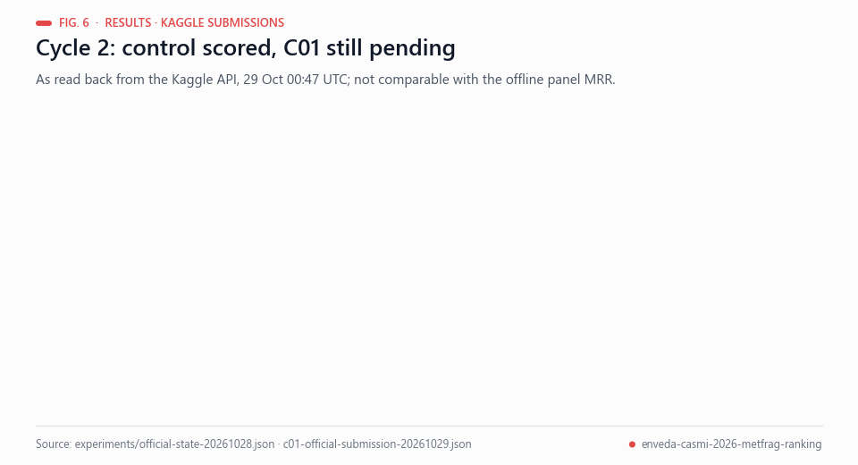<br><sub>Fig. 6 — Kaggle submission state as read back from the API, 29 Oct 00:47 UTC. Data: experiments/official-state-20261028.json and c01-official-submission-20261029.json.</sub></p>

| ID | Description | Public LB | Private LB |
|---|---|---|---|
| C00 / 57729674 | Control: credited public 0.472 recipe, unchanged | **API COMPLETE: 0.472** | after 14 Dec |
| C01 | Control + MetFrag voter (w = 0.25) | receipt/score not independently verified | after 14 Dec |

The full experiment log, including negative results, is in [experiments/LOG.md](experiments/LOG.md) and
[experiments/experiments.csv](experiments/experiments.csv).

## Reproduce

<p align="center">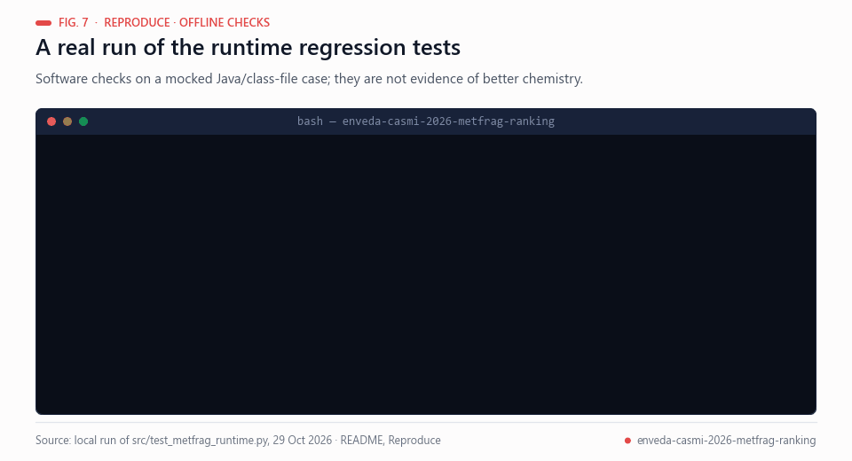<br><sub>Fig. 7 — A real local run of the offline runtime tests; the stage test needs the public panel, which is not in the repository, and could not be run.</sub></p>

```bash
pip install -r requirements.txt
# 1) offline panel experiment (needs the public dataset sanpier/catalogue-experiment-saner)
kaggle datasets download sanpier/catalogue-experiment-saner -p data/catalogue --unzip
python src/e00_panel_proxy_check.py                       # E00: is the panel a valid proxy?
python src/e01_eval.py path/to/e01_metfrag_scores.parquet  # E01: fusion rules + bootstrap
python src/test_metfrag_stage.py                          # unit test of the deployable stage
# 2) MetFrag scores themselves are produced on Kaggle CPU (Java 21 is pre-installed):
#    src/e01_metfrag_panel.py is the exact kernel script
```

The submission notebook is public on Kaggle:
[`franciscoangulo/enveda-casmi-c01-metfrag-voter`](https://www.kaggle.com/code/franciscoangulo/enveda-casmi-c01-metfrag-voter)
— the 0.472 control plus [`src/metfrag_stage.py`](src/metfrag_stage.py) as Stage 4. The MetFrag jar is mirrored,
unmodified, as the Kaggle dataset `franciscoangulo/metfrag-commandline-2611` for internet-off runs.

No competition data is stored in this repository (the data licence is CC BY-NC 4.0 and forbids redistribution).

## Repository layout

```
src/metfrag_stage.py        deployable Stage 4 (MetFrag voter, budget guard, partial application, validation)
src/e01_metfrag_panel.py    Kaggle kernel: MetFrag on the labelled panel
src/e01_eval.py             fusion rules, paired bootstrap, molecule-disjoint folds
src/e01b_spectra_budget.py  how many spectra per molecule are needed
src/e00_panel_proxy_check.py checks whether the panel predicts the leaderboard
src/test_metfrag_stage.py   unit test with a mocked MetFrag
tools/make_gifs.py          all animated figures
experiments/                LOG.md, experiments.csv, JSON results
```

## Credits

This entry stands on public work by many Kaggle authors; all pipeline credit is theirs.

| Contribution | Authors |
|---|---|
| 0.472 leader-safe recipe (w_mid 0.75) | [Alex Chilton](https://www.kaggle.com/code/alexchilton/casmi26-lb-0-472-leader-safe-ranks-2-25-at-0-75) |
| *From Peaks to Structures* consensus layer (0.468) | [Roman Rozen](https://www.kaggle.com/code/romanrozen/0-468-casmi-from-peaks-to-structures) |
| Candidate-aware PubChem promotion (0.465), spectrum↔structure model, neural fusion (0.466) | [Saner Turhaner (sanpier)](https://www.kaggle.com/code/sanpier/pubchem-neural025-lb-0-466) |
| Attributed reproduction assets, PubChem prior, NP panel, fold-safe FPNet | [Dmitrii Gluzdov](https://www.kaggle.com/code/dmitriigluzdov/casmi-26-from-spectra-to-structures) |
| Complete inference base (E006) | [canqiang](https://www.kaggle.com/code/canqiang/casmi26-e006-window-40-ice-fallback-true) |
| MetFrag | C. Ruttkies, E. L. Schymanski, S. Wolf, J. Hollender, S. Neumann — *J. Cheminform.* 8:3 (2016), [doi:10.1186/s13321-016-0115-9](https://doi.org/10.1186/s13321-016-0115-9) |
| RDKit | [rdkit.org](https://www.rdkit.org) |

Competition: D. Healey *et al.*, *Enveda CASMI 2026 – Molecule ID From Mass Spectra*, Kaggle, 2026.

## Limitations and notes

<p align="center">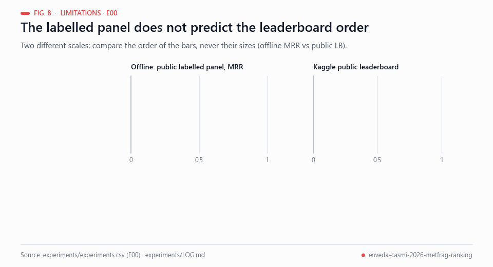<br><sub>Fig. 8 — E00: offline panel versus public leaderboard (different scales; compare order only). Data: experiments/experiments.csv.</sub></p>

- The only public labelled panel consists of library molecules (control MRR 0.91 vs ~0.47 on the hidden test) and
  it mis-ranked a board-validated change in our check E00, so offline gains are treated as directional evidence.
  Building a hidden-like replay panel (answers removed from the training library) is the main open item.
- MetFrag costs ~16 s per spectrum on Kaggle CPU; the stage has a 90-minute budget and applies to the molecules it
  finishes, so on a slow rerun some molecules keep the control order.

<p align="center">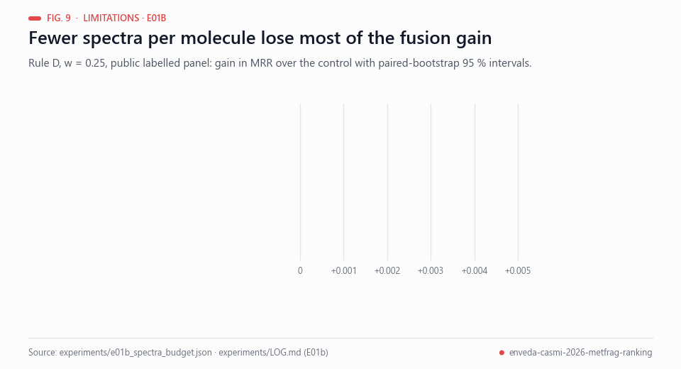<br><sub>Fig. 9 — E01b: fusion gain at w = 0.25 by spectra per molecule. Data: experiments/e01b_spectra_budget.json.</sub></p>

- Using fewer spectra per molecule weakens the effect (E01b), so the stage keeps up to six.
- Our earlier September lineage (v1–v62, best 0.348) is retired; the public plateau superseded it.

## Real-world applications

<p align="center">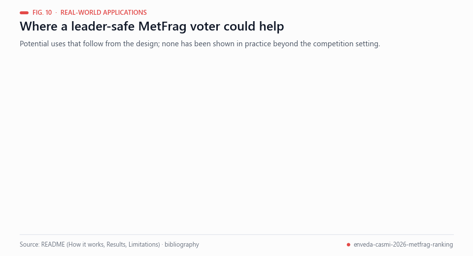<br><sub>Fig. 10 — Where a leader-safe MetFrag voter could help. These are potential uses, not demonstrated outcomes.</sub></p>

The measured design is deliberately narrow, so the realistic uses are narrow too; none of the following has been
shown outside the competition setting:

- **Natural-product triage.** A ranked list of candidate structures for unknown LC-MS/MS features could help decide
  which compounds to isolate or re-measure first; natural products remain a major source of new drugs [[16](#ref-16)].
- **Evidence an analyst can inspect.** MetFrag explains which measured peaks each candidate's fragments account for,
  which is easier to audit than a score alone and fits confidence-level reporting [[8](#ref-8), [9](#ref-9)].
- **A safe add-on to an existing pipeline.** Because rank 1 and the candidate set are never changed, a validated
  pipeline keeps its answers while ranks 2–25 are re-ordered.
- **Internet-off runs.** The pinned Java 21 runtime, the unmodified jar and the integrity gate are designed for
  internet-off runs on Kaggle; use in other locked-down environments has not been tested.
- **A template for evaluation.** The fixed control, pre-registered rules, paired bootstrap [[11](#ref-11)] and logged
  negative results can be reused for other ranking challenges.

## Possible improvements

<p align="center">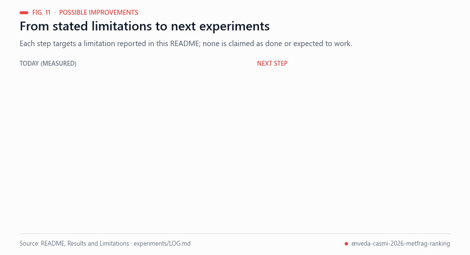<br><sub>Fig. 11 — Most proposals target a limitation stated above; none is claimed as done or as likely to work.</sub></p>

- **A hidden-like replay panel.** The labelled panel comes from library molecules (control MRR 0.91 versus ~0.47 on the
  hidden test) and mis-ranked a board-validated change in E00. Removing the answers from the training library when
  replaying the panel would make offline evidence closer to the test distribution.
- **More statistical power.** Only about 15 panel molecules can move, and the w = 0.25 gain (+0.0017) sits below the
  +0.005 validation threshold. A larger replay panel, with intervals adjusted for multiple comparisons, would
  separate a small real effect from noise [[11](#ref-11)].
- **Runtime.** At ~16 s per spectrum and a 90-minute budget, some molecules keep the control order on a slow rerun.
  Profiling the stage and testing cheaper candidate scoring is a proposed next step.
- **Which spectra to use.** Fewer spectra weaken the gain (E01b); choosing the six spectra by a criterion other than
  the current one (timsTOF first, then most peaks) is an open question to test.
- **Feature contract for the weighting models.** The weighting models use the original sim-ranker features, not the
  notebook's, so they are not inserted. Re-training on the notebook's own features and re-evaluating with the same
  fixed rules would test whether the positive library-removed result transfers; the second regime's delta was
  slightly negative.
- **Learned fragmentation as another voter.** Neural fragmentation-graph models [[6](#ref-6)] could be evaluated as an
  additional independent voter under the same leader-safe rule. ICEBERG is already used in step 1 of the control; this
  would test it as an additional rank 2–25 voter.

## Future work

<p align="center">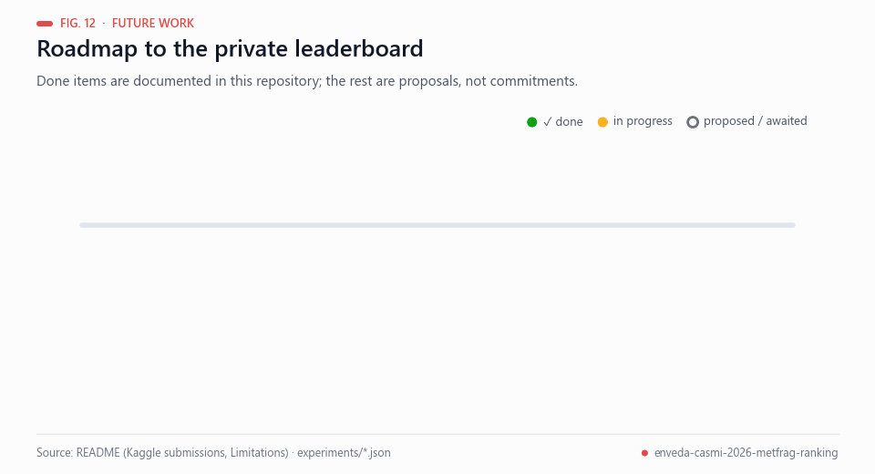<br><sub>Fig. 12 — Completed milestones are documented in this repository; the rest are proposals, not commitments.</sub></p>

Proposed next steps (not commitments):

1. Read the public score of the pending C01 submission when the competition reports it, and record it next to the
   unchanged C00 control without comparing it to the offline panel numbers.
2. Build the hidden-like replay panel and repeat E01 on it under the same pre-registered rule.
3. Any further board submission would need a new pre-registered rule, because E01 allows one exploratory submission
   (C01).
4. After the private leaderboard is published (after 14 Dec), add the final result with its limitations.

## License

Code: [MIT](LICENSE) (the competition's winner licence). MetFrag is LGPL-2.1 and is used as an unmodified binary.

## Bibliography

1. <a id="ref-1"></a>Wolf, S., Schmidt, S., Müller-Hannemann, M., & Neumann, S. (2010). In silico fragmentation for computer assisted identification of metabolite mass spectra. *BMC Bioinformatics*, 11, 148. https://doi.org/10.1186/1471-2105-11-148
2. <a id="ref-2"></a>Ruttkies, C., Schymanski, E. L., Wolf, S., Hollender, J., & Neumann, S. (2016). MetFrag relaunched: incorporating strategies beyond in silico fragmentation. *Journal of Cheminformatics*, 8, 3. https://doi.org/10.1186/s13321-016-0115-9
3. <a id="ref-3"></a>Schymanski, E. L., Ruttkies, C., Krauss, M., et al. (2017). Critical Assessment of Small Molecule Identification 2016: automated methods. *Journal of Cheminformatics*, 9, 22. https://doi.org/10.1186/s13321-017-0207-1
4. <a id="ref-4"></a>Dührkop, K., Shen, H., Meusel, M., Rousu, J., & Böcker, S. (2015). Searching molecular structure databases with tandem mass spectra using CSI:FingerID. *Proceedings of the National Academy of Sciences*, 112(41), 12580–12585. https://doi.org/10.1073/pnas.1509788112
5. <a id="ref-5"></a>Dührkop, K., Fleischauer, M., Ludwig, M., et al. (2019). SIRIUS 4: a rapid tool for turning tandem mass spectra into metabolite structure information. *Nature Methods*, 16(4), 299–302. https://doi.org/10.1038/s41592-019-0344-8
6. <a id="ref-6"></a>Goldman, S., Li, J., & Coley, C. W. (2023). Generating Molecular Fragmentation Graphs with Autoregressive Neural Networks. *arXiv* 2304.13136. https://arxiv.org/abs/2304.13136
7. <a id="ref-7"></a>Goldman, S., Wohlwend, J., Stražar, M., et al. (2023). Annotating metabolite mass spectra with domain-inspired chemical formula transformers. *Nature Machine Intelligence*, 5(9), 965–979. https://doi.org/10.1038/s42256-023-00708-3
8. <a id="ref-8"></a>Schymanski, E. L., Jeon, J., Gulde, R., et al. (2014). Identifying Small Molecules via High Resolution Mass Spectrometry: Communicating Confidence. *Environmental Science & Technology*, 48(4), 2097–2098. https://doi.org/10.1021/es5002105
9. <a id="ref-9"></a>Alseekh, S., Aharoni, A., Brotman, Y., et al. (2021). Mass spectrometry-based metabolomics: a guide for annotation, quantification and best reporting practices. *Nature Methods*, 18(7), 747–756. https://doi.org/10.1038/s41592-021-01197-1
10. <a id="ref-10"></a>Cormack, G. V., Clarke, C. L. A., & Buettcher, S. (2009). Reciprocal rank fusion outperforms condorcet and individual rank learning methods. *Proceedings of the 32nd international ACM SIGIR conference on Research and development in information retrieval*, 758–759. https://doi.org/10.1145/1571941.1572114
11. <a id="ref-11"></a>Efron, B. (1979). Bootstrap Methods: Another Look at the Jackknife. *The Annals of Statistics*, 7(1), 1–26. https://doi.org/10.1214/aos/1176344552
12. <a id="ref-12"></a>Sorokina, M., Merseburger, P., Rajan, K., Yirik, M. A., & Steinbeck, C. (2021). COCONUT online: Collection of Open Natural Products database. *Journal of Cheminformatics*, 13, 2. https://doi.org/10.1186/s13321-020-00478-9
13. <a id="ref-13"></a>Kim, S., Chen, J., Cheng, T., et al. (2022). PubChem 2023 update. *Nucleic Acids Research*, 51(D1), D1373–D1380. https://doi.org/10.1093/nar/gkac956
14. <a id="ref-14"></a>Landrum, G. *RDKit: Open-source cheminformatics*. https://www.rdkit.org
15. <a id="ref-15"></a>Healey, D., et al. (2026). *Enveda CASMI 2026 – Molecule ID From Mass Spectra*. Kaggle competition. https://www.kaggle.com/competitions/enveda-CASMI26-molecule-id-mass-spectra
16. <a id="ref-16"></a>Newman, D. J., & Cragg, G. M. (2020). Natural products as sources of new drugs over the nearly four decades from 01/1981 to 09/2019. *Journal of Natural Products*, 83(3), 770–803. https://doi.org/10.1021/acs.jnatprod.9b01285

---

<div align="center">
<sub>Built by <a href="https://github.com/Agnuxo1">Francisco Angulo de Lafuente</a> · every figure added in docs/readme is an
animated rendering of the published file named in its footer · <a href="#spectra--structures-metfrag-assisted-ranking-for-enveda-casmi-2026">back to top ↑</a></sub>
</div>
