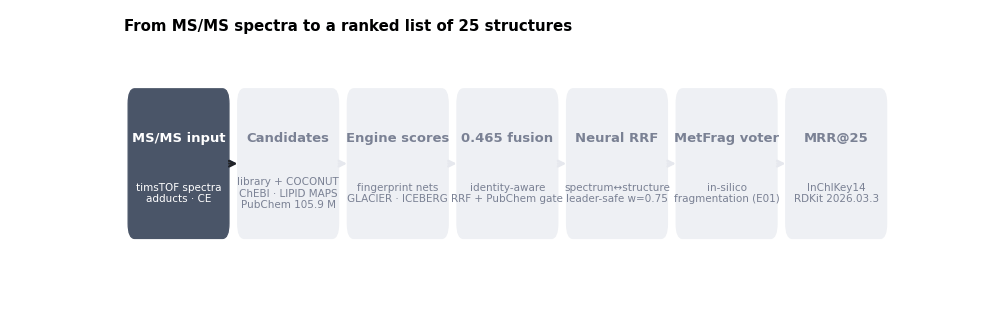
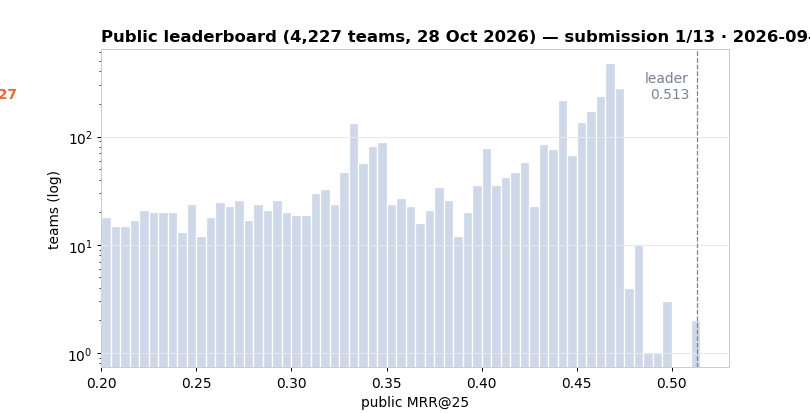
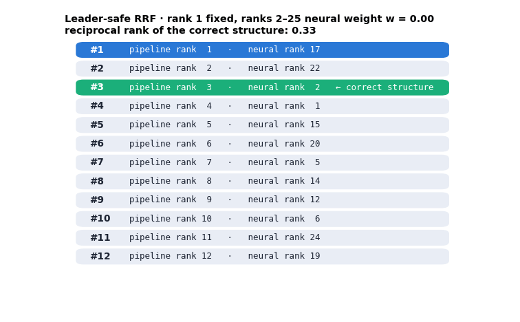
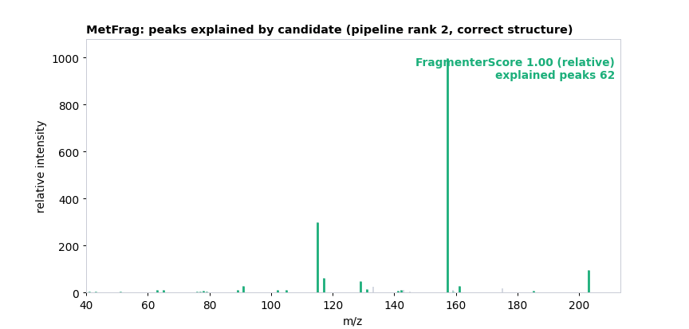
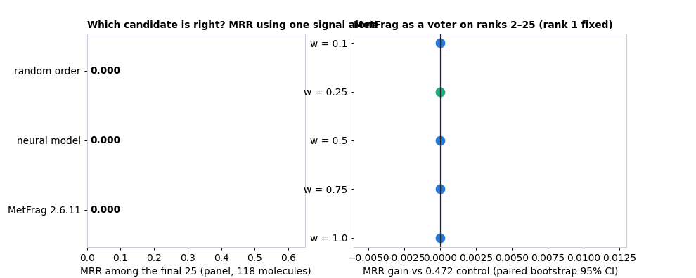

# Spectra → Structures: MetFrag-assisted ranking for Enveda CASMI 2026

**Predicting the 2D structure of natural products from LC-MS/MS spectra, ranked by evidence.**
Our entry to the [Enveda CASMI 2026 Kaggle competition](https://www.kaggle.com/competitions/enveda-CASMI26-molecule-id-mass-spectra)
(MRR@25, 4,200+ teams, US$50,000).



| | |
|---|---|
| **Task** | For each unknown molecule (1–9 timsTOF MS/MS spectra), return up to 25 candidate SMILES, best first |
| **Metric** | Mean reciprocal rank @25 on the InChIKey connectivity block after RDKit 2026.03.3 tautomer canonicalisation |
| **Base** | The strongest public pipeline (0.465 → 0.472), credited below, run unchanged as our **control** |
| **Our contribution** | An independent, physics-based voter: **MetFrag 2.6.11 in-silico fragmentation** re-orders ranks 2–25 |
| **Method** | Pre-registered hypotheses, a fixed control, paired bootstrap and molecule-disjoint folds; negatives logged |
| **Author** | Francisco Angulo de Lafuente ([@Agnuxo1](https://github.com/Agnuxo1) · Kaggle `franciscoangulo`) |

---

## 28 October: experimental weighting models and checked submission state

The repository now includes a reusable [CPU trainer](src/experimental_weighting.py)
and [fixed-blend inference utility](src/weighting_predict.py), rather than only
metric summaries. The trainer exports three estimators and verifies that loading
each export reproduces its predictions exactly. These use the **first31 columns
of the original sim-ranker feature matrix**, not the features of the current
MetFrag notebook, and are not automatically inserted into that notebook.

Three fixed interventions were tested on observed-spectrum features under two
simulated retrieval regimes, training on six libraries and reserving250 Enveda
molecules (500 query groups):

| Method | Library removed MRR@25 | True-structure spectra removed MRR@25 |
|---|---:|---:|
| Fixed HGB control | 0.79122 | 0.64561 |
| M4: equal total weight per query | 0.79673 | 0.62628 |
| M5: positive candidate weight ×5 | 0.81035 | 0.63504 |
| M6: fixed 50/50 M4/M5 probability blend | **0.81796** | 0.64308 |

In the library-removed regime, the blend improves MRR by **+0.02674**, with
95% molecule-bootstrap interval **[+0.00604,+0.04782]**. This positive result
is retained alongside the second regime's delta -0.00254, interval
[-0.01831,+0.01409]. These exploratory intervals are not multiplicity-adjusted.

The blend improves overall mean MRR by **+0.01210**, molecule-cluster bootstrap
95% CI [-0.00150,+0.02557];64 groups improve and51 worsen. The positive first
regime and slightly negative second regime are both retained. These are derived
retrieval simulations, **not official scores or a comparison with the current
MetFrag candidate**. Exact chemical overlap across libraries cannot be ruled
out from this numeric matrix alone. [All results](experiments/weighting/results.json)
and [per-query outcomes](experiments/weighting/group_metrics.csv) are available.

```sh
pip install -r requirements-weighting.txt
python src/experimental_weighting.py --data /path/to/sim_rank_rows_nofp.npz --out output --export-models
python src/weighting_predict.py --features candidate_features.npy --models output --out scores.npy
```

The fitted estimators are also committed in
[`models/experimental-weighting/`](models/experimental-weighting/); their hashes
and successful export-roundtrip checks are recorded in the results JSON.

**Official-state update, 28 October:** the authenticated Kaggle API now reports
C00 submission **57729674 as COMPLETE, public score 0.472**. This verifies our
reproduction of the credited public control, improving the account's earlier
best 0.348 by **+0.124**. It is not evidence of a MetFrag improvement: C01's
notebook completed, but a scored C01 competition receipt has not yet been
verified. [Checked receipt](experiments/official-state-20261028.json).
No duplicate C00 submission was made by this update.

**C01 runtime history:** version4's completed Kaggle output scored **zero molecules**:
its GPU image used Java 17, while the jar's main class requires Java 21
(class-file version 65). Its `submission.csv` remained the control, so it is
not submitted again as an improvement. **Version5 already succeeded** with its
own Java21 fallback: **40/40 jobs,12 visible molecules scored and12 lists
reordered**, with no Java failures and167seconds in MetFrag. The browser's
selected Version5 output and report hash are preserved in
[this positive runtime record](experiments/c01-version5-visible-proof.json).
Those are training-library smoke cases, not a hidden-test score. They must not
be erased by the earlier failure or by subsequent packaging work.

The hardened stage now checks JVM/class
compatibility before reading spectra, honours an explicit `METFRAG_JAVA`
executable, rejects failed Java calls even if an old CSV exists, and applies
only molecules whose every selected spectrum scored successfully. Zero fully
scored molecules is reported as **unapplied**, rather than a successful change.
Two offline regressions cover the observed Java-17 failure and Java-21
compatibility; these are software checks, not evidence of better chemistry.
Private Kaggle notebook version **7** now carries a pinned official
[Temurin 21 JRE dataset](https://www.kaggle.com/datasets/franciscoangulo/temurin21-jre-linux-x64-pinned).
The [bootstrap](src/bootstrap_java21.py) verifies the vendor archive's byte count
and SHA-256 before extracting it into this notebook's own working directory;
it leaves system Java unchanged. Vendor licences remain inside the unmodified
archive. Dataset version1 was automatically unpacked by Kaggle, so notebook6
stopped before MetFrag with `StopIteration`. Dataset version2 preserves the
byte-identical archive as `.tar.gz.bin`; Kaggle's file listing verifies its
52,181,297 bytes. The bootstrap now runs before the expensive pipeline.
[Runtime provenance](experiments/c01-runtime-repair.json) records the
release and hashes. Version7 is running; successful scoring and a competition
receipt remain to be checked. This repair leaves weight 0.25 and the six-spectrum
rule unchanged. Preview/sample outputs do not establish a hidden-test gain.

## Highlights

- **MetFrag carries strong, independent evidence.** On the public labelled panel, ordering each molecule's final
  25 candidates by MetFrag alone puts the correct structure at a mean reciprocal rank of **0.554** — better than
  the learned spectrum↔structure network (**0.441**) and 3.6× the random-order expectation (**0.153**).
- **Leader-safe by construction.** The control's rank-1 answer and its candidate set are never changed; MetFrag only
  re-orders ranks 2–25, where a wrong move costs little and a right one is worth up to 0.5 per molecule.
- **Positive, statistically supported gain on the panel.** At weight 0.25 the deployable rule improves the control by
  **+0.0017 MRR, 95% CI [+0.0001, +0.0040]**; larger weights reach +0.0038 with wider intervals.
- **Internet-off deployment candidate.** The unmodified MetFrag jar uses the pinned JRE 21 dataset;
  the selected GPU image's built-in Java 17 is incompatible. The stage enforces
  its 9-hour session deadline and falls back to the control on failure. A live
  successful run of the repaired version is still required.
- **Re-based from the historical0.348 lineage onto the credited0.472 public recipe.**
  Our C00 reproduction now has a verified public score of **0.472**; the MetFrag layer is a measured
  offline candidate for improving that control.



## How it works

### 1 · Candidate generation and the 0.465 fusion (public, unchanged)
Three engines propose structures within 10 ppm of the neutral mass: a library/analogue engine over 0.71 M stored
structures (training set + COCONUT), a second engine over ChEBI, LIPID MAPS and PubChemLite, and a PubChem channel
that screens 105.9 M structures with fingerprint models and a documentation prior. Identity-aware fusion merges them
and the GLACIER/ICEBERG forward models re-order same-formula candidates.

### 2 · Leader-safe neural reciprocal-rank fusion (public, unchanged)
A spectrum↔structure network re-ranks the list with reciprocal-rank fusion. Rank 1 uses neural weight 0.25; ranks
2–25 use 0.75 — the public 0.472 recipe.



### 3 · MetFrag voter on ranks 2–25 (this work)
[MetFrag](https://github.com/ipb-halle/MetFragRelaunched) (Ruttkies *et al.*, 2016) breaks every candidate's
molecular graph *in silico* (up to two bond cleavages), and scores how much of the measured MS/MS intensity its
fragments explain. For each molecule we run it on up to six spectra, normalise per spectrum and average, then fuse:

$$s_i = \frac{1}{3 + \mathrm{pos}_i^{\text{control}}} + \frac{w}{3 + \mathrm{rank}_i^{\text{MetFrag}}},\qquad i \in \text{ranks } 2\text{–}25,\quad w = 0.25$$



*Green peaks: fragments explained by the correct structure, which the pipeline had placed second; orange: decoys.*

## Results

### Offline: does MetFrag help? (experiment E01, public labelled panel, 118 molecules)



| Rule (rank 1 fixed) | MRR | Δ vs control | 95% CI (paired bootstrap, 4,000) | Folds (3, molecule-disjoint) |
|---|---|---|---|---|
| Control (0.472 recipe) | 0.9128 | — | — | — |
| + MetFrag, w = 0.25 (**C01 candidate**) | 0.9146 | **+0.0017** | [+0.0001, +0.0040] | +0.0005 / +0.0047 / 0.0000 |
| + MetFrag, w = 0.50 | 0.9142 | +0.0014 | [−0.0028, +0.0054] | +0.0018 / +0.0065 / −0.0042 |
| + MetFrag, w = 0.75 | 0.9166 | +0.0038 | [−0.0018, +0.0105] | +0.0053 / +0.0101 / −0.0042 |

The panel is drawn from library molecules, so the control already ranks ~88% of them first; only about 15 molecules
can move at all. On the hidden natural-product test the control's MRR is ~0.47, so far more answers sit in ranks
2–25, which is exactly where the voter acts.

### Kaggle submissions (cycle 2, 28 Oct 2026)

| ID | Description | Public LB | Private LB |
|---|---|---|---|
| C00 / 57729674 | Control: credited public 0.472 recipe, unchanged | **API COMPLETE: 0.472** | after 14 Dec |
| C01 | Control + MetFrag voter (w = 0.25) | receipt/score not independently verified | after 14 Dec |

The full experiment log, including negative results, is in [experiments/LOG.md](experiments/LOG.md) and
[experiments/experiments.csv](experiments/experiments.csv).

## Reproduce

```bash
pip install -r requirements.txt
# 1) offline panel experiment (needs the public dataset sanpier/catalogue-experiment-saner)
kaggle datasets download sanpier/catalogue-experiment-saner -p data/catalogue --unzip
python src/e00_panel_proxy_check.py                       # E00: is the panel a valid proxy?
python src/e01_eval.py path/to/e01_metfrag_scores.parquet  # E01: fusion rules + bootstrap
python src/test_metfrag_stage.py                          # unit test of the deployable stage
# 2) MetFrag scores themselves are produced on Kaggle CPU (Java 21 is pre-installed):
#    src/e01_metfrag_panel.py is the exact kernel script
```

The submission notebook is public on Kaggle:
[`franciscoangulo/enveda-casmi-c01-metfrag-voter`](https://www.kaggle.com/code/franciscoangulo/enveda-casmi-c01-metfrag-voter)
— the 0.472 control plus [`src/metfrag_stage.py`](src/metfrag_stage.py) as Stage 4. The MetFrag jar is mirrored,
unmodified, as the Kaggle dataset `franciscoangulo/metfrag-commandline-2611` for internet-off runs.

No competition data is stored in this repository (the data licence is CC BY-NC 4.0 and forbids redistribution).

## Repository layout

```
src/metfrag_stage.py        deployable Stage 4 (MetFrag voter, budget guard, partial application, validation)
src/e01_metfrag_panel.py    Kaggle kernel: MetFrag on the labelled panel
src/e01_eval.py             fusion rules, paired bootstrap, molecule-disjoint folds
src/e01b_spectra_budget.py  how many spectra per molecule are needed
src/e00_panel_proxy_check.py checks whether the panel predicts the leaderboard
src/test_metfrag_stage.py   unit test with a mocked MetFrag
tools/make_gifs.py          all animated figures
experiments/                LOG.md, experiments.csv, JSON results
```

## Credits

This entry stands on public work by many Kaggle authors; all pipeline credit is theirs.

| Contribution | Authors |
|---|---|
| 0.472 leader-safe recipe (w_mid 0.75) | [Alex Chilton](https://www.kaggle.com/code/alexchilton/casmi26-lb-0-472-leader-safe-ranks-2-25-at-0-75) |
| *From Peaks to Structures* consensus layer (0.468) | [Roman Rozen](https://www.kaggle.com/code/romanrozen/0-468-casmi-from-peaks-to-structures) |
| Candidate-aware PubChem promotion (0.465), spectrum↔structure model, neural fusion (0.466) | [Saner Turhaner (sanpier)](https://www.kaggle.com/code/sanpier/pubchem-neural025-lb-0-466) |
| Attributed reproduction assets, PubChem prior, NP panel, fold-safe FPNet | [Dmitrii Gluzdov](https://www.kaggle.com/code/dmitriigluzdov/casmi-26-from-spectra-to-structures) |
| Complete inference base (E006) | [canqiang](https://www.kaggle.com/code/canqiang/casmi26-e006-window-40-ice-fallback-true) |
| MetFrag | C. Ruttkies, E. L. Schymanski, S. Wolf, J. Hollender, S. Neumann — *J. Cheminform.* 8:3 (2016), [doi:10.1186/s13321-016-0115-9](https://doi.org/10.1186/s13321-016-0115-9) |
| RDKit | [rdkit.org](https://www.rdkit.org) |

Competition: D. Healey *et al.*, *Enveda CASMI 2026 – Molecule ID From Mass Spectra*, Kaggle, 2026.

## Limitations and notes

- The only public labelled panel consists of library molecules (control MRR 0.91 vs ~0.47 on the hidden test) and
  it mis-ranked a board-validated change in our check E00, so offline gains are treated as directional evidence.
  Building a hidden-like replay panel (answers removed from the training library) is the main open item.
- MetFrag costs ~16 s per spectrum on Kaggle CPU; the stage has a 90-minute budget and applies to the molecules it
  finishes, so on a slow rerun some molecules keep the control order.
- Using fewer spectra per molecule weakens the effect (E01b), so the stage keeps up to six.
- Our earlier September lineage (v1–v62, best 0.348) is retired; the public plateau superseded it.

## License

Code: [MIT](LICENSE) (the competition's winner licence). MetFrag is LGPL-2.1 and is used as an unmodified binary.
